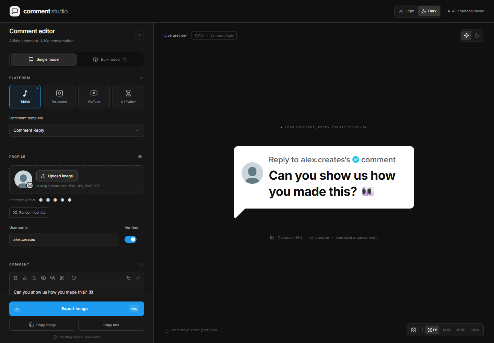
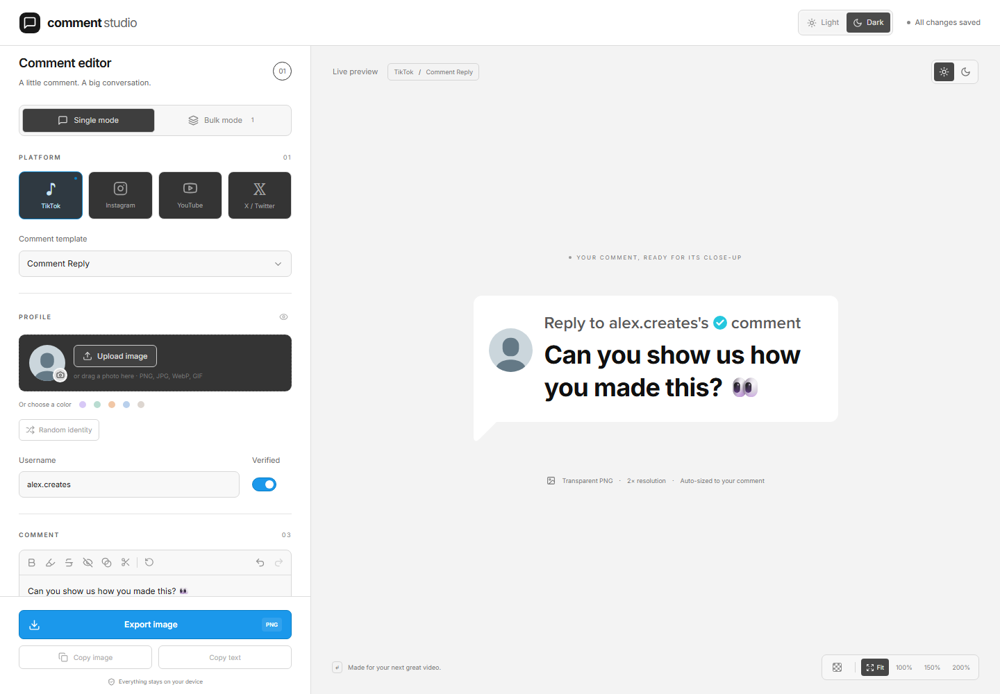
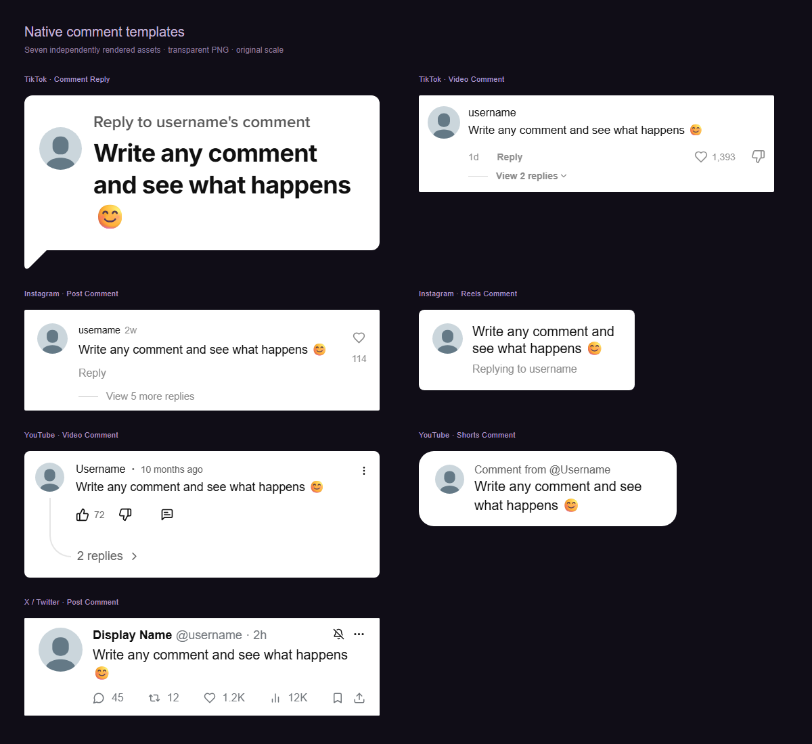

  
  <h1>Comment Studio</h1>
  
Turn a comment into a clean PNG for your next video.

  
A private Windows app for TikTok, Instagram, YouTube, and X comment images.

  

    <a href="https://github.com/Haejinka/comment-studio/releases/latest/download/Comment-Studio-Setup.exe"><strong>Download for Windows</strong></a>
    &nbsp;·&nbsp;
    <a href="https://github.com/Haejinka/comment-studio/releases/latest/download/Comment-Studio.exe">Open without installing</a>
    &nbsp;·&nbsp;
    <a href="docs/QUICK_START.md">Quick start</a>
  

  

 

<picture>
  <source media="(prefers-color-scheme: dark)" srcset="docs/images/editor-dark.png">
  <source media="(prefers-color-scheme: light)" srcset="docs/images/editor-light.png">
  
</picture>

**No account. No watermark. No subscription.** Your drafts and uploaded photos stay on your computer. The Windows app works without a terminal or local web server.

[Download](#download) · [Make your first image](#make-your-first-image) · [Templates](#seven-templates-four-platforms) · [Guides](#find-the-right-guide) · [FAQ](#frequently-asked-questions)

## Download

| Choose this                                  | Download                                                                                                          | What to expect                                         |
| -------------------------------------------- | ----------------------------------------------------------------------------------------------------------------- | ------------------------------------------------------ |
| **I want a normal Windows app**              | [Windows installer](https://github.com/Haejinka/comment-studio/releases/latest/download/Comment-Studio-Setup.exe) | Installs the app for your Windows account. About 3 MB. |
| **I want to try it without installing**      | [Standalone app](https://github.com/Haejinka/comment-studio/releases/latest/download/Comment-Studio.exe)          | Double-click the file to open. About 10 MB.            |
| **I want release details or older versions** | [All releases](https://github.com/Haejinka/comment-studio/releases)                                               | Release notes, downloads, checksums, and the app icon. |

**For Windows 10/11, 64-bit Intel or AMD PCs.** The app uses Microsoft Edge WebView2. The installer can download the runtime if it is missing; normal editing and exporting work offline. You do not need to install Node.js or Rust to use the Windows downloads.

> [!NOTE]
> Current builds are unsigned, so Windows may show an unknown-publisher notice. Download the app from this repository’s Releases page. See [installation help](docs/TROUBLESHOOTING.md#windows-says-the-publisher-is-unknown) for details.

## Make your first image

| Step             | What to do                                                               |
| ---------------- | ------------------------------------------------------------------------ |
| **1. Open**      | Download and open Comment Studio.                                        |
| **2. Choose**    | Pick a platform and a comment template.                                  |
| **3. Customize** | Enter a name and comment. Click **Upload image** to use a profile photo. |
| **4. Save**      | Click **Export image**, choose a folder, and save your PNG.              |

The default PNG has a transparent background and 2× resolution. Drop it into your video editor as an overlay. Use **Copy image** when you want to paste the image into an app that supports image pasting.

**[Follow the illustrated quick start →](docs/QUICK_START.md)**

<strong>See the light and dark interfaces</strong>

The header’s **Light / Dark** buttons change the editor. The preview’s sun/moon buttons change the comment image. These are separate settings.

| Dark interface                                                                | Light interface                                                                  |
| ----------------------------------------------------------------------------- | -------------------------------------------------------------------------------- |
|  |  |

Click either screenshot to view it at full size.

## Seven templates, four platforms

| Platform        | Templates                                                |
| --------------- | -------------------------------------------------------- |
| **TikTok**      | Reply speech bubble · Video comment                      |
| **Instagram**   | Post comment · Reels reply sticker                       |
| **YouTube**     | Video comment with reply thread · Shorts comment sticker |
| **X / Twitter** | Post comment                                             |

<strong>Preview all seven templates</strong>

## What you can do

- **Make it yours:** profile images, verified badges, names, handles, timestamps, engagement counts, and visibility controls.
- **Style the comment:** bold, highlight, strikethrough, blur, and visual redaction; undo and redo included.
- **Export a usable asset:** transparent or solid backgrounds, automatic height, adjustable padding, and 1×–4× PNG resolution.
- **Create a batch:** add, duplicate, reorder, select, or import comments from CSV; save PNGs together in a ZIP.
- **Keep your work:** automatic local drafts, reusable presets, and JSON draft backups.

Repeated Windows exports suggest numbered filenames such as `comment (2).png`. Your earlier export is not silently replaced.

## Find the right guide

| I want to…                                   | Open this guide                            |
| -------------------------------------------- | ------------------------------------------ |
| Make my first comment image                  | [Quick start](docs/QUICK_START.md)         |
| Understand the controls and export settings  | [Using the editor](docs/USER_GUIDE.md)     |
| Create many comments from a spreadsheet      | [Bulk mode and CSV](docs/BULK_AND_CSV.md)  |
| Move browser drafts into the Windows app     | [Back up and move drafts](docs/BACKUPS.md) |
| Fix a download, export, or clipboard problem | [Troubleshooting](docs/TROUBLESHOOTING.md) |
| Run, test, or build the source               | [Developer guide](docs/DEVELOPMENT.md)     |

## Frequently asked questions

<strong>Do I need an account or an internet connection?</strong>

No account is needed. The Windows app edits and exports locally. The installer may need an internet connection once if WebView2 is missing. Building from source also needs an initial dependency download.

<strong>Will this post a comment on social media?</strong>

No. It creates image files. It does not connect to social accounts or post anything.

<strong>Where are my drafts?</strong>

Drafts stay in the browser or Windows app profile where you created them. Browser and Windows app drafts are separate. Use **Draft backups → Export backup** to keep a portable copy. [Backup guide →](docs/BACKUPS.md)

<strong>Why does the font or emoji look different on another computer?</strong>

Emoji rendering follows the operating system. The TikTok reply heading uses Proxima Nova Semibold when it is already installed, and falls back to bundled Inter otherwise. Proxima font files are not included. [Font and asset notices →](public/licenses/README.md)

<strong>Does blur or redaction remove the original text?</strong>

It changes the exported image’s appearance. Original text remains in drafts, copied plain text, presets, and ZIP manifest data. Use **Remove selected text** when you want to delete text from the comment itself.

<strong>How do I update the app?</strong>

Export a draft backup, download the new version from [Releases](https://github.com/Haejinka/comment-studio/releases), close the running app, and open or install the new version. There is no automatic updater.

## Samples and feedback

Try the [sample CSV](samples/sample-comments.csv), inspect a real [transparent PNG](samples/example-comment.png), or download an [example ZIP](samples/example-comments.zip).

Found a problem? [Report a bug](https://github.com/Haejinka/comment-studio/issues/new?template=bug_report.yml). Have an idea? [Suggest a feature](https://github.com/Haejinka/comment-studio/issues/new?template=feature_request.yml).

Built with **Rust + Tauri**, **React**, and **TypeScript**. The browser editor remains available for local development. Platform names identify the image styles; this project is not affiliated with TikTok, Instagram, YouTube, or X.
