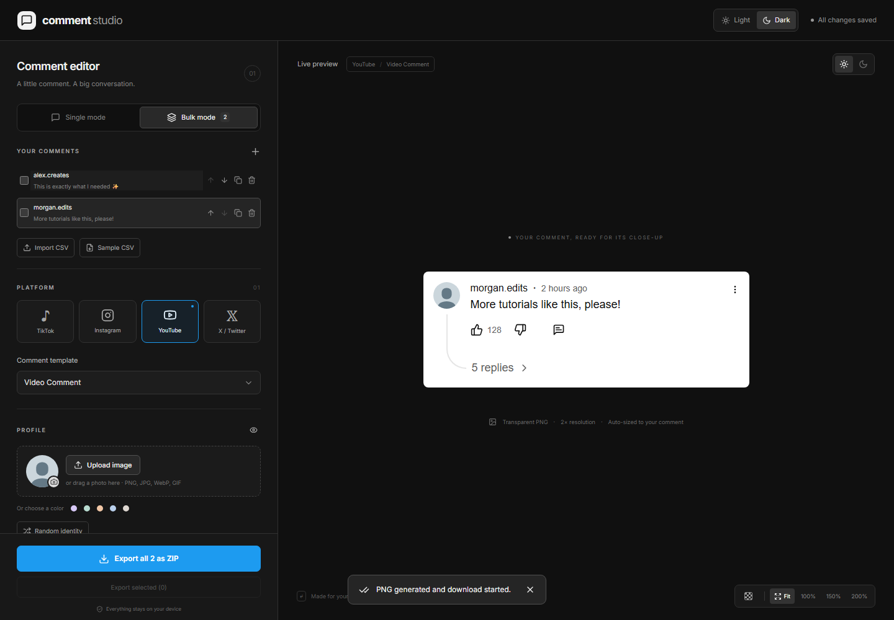

# Bulk mode and CSV

[← Home](../README.md) · [Using the editor](USER_GUIDE.md)

Bulk mode creates several separate comment images in one session.

## Create a small batch

1. Choose **Bulk mode** at the top of the sidebar.
2. Use **+ Add comment** to create another item.
3. Select a row to edit that comment’s profile, text, platform, and template.
4. Use the duplicate, remove, and up/down controls to manage the list.
5. Choose **Export all … as ZIP** to save every comment.

Each item keeps its own values. Editing one does not rewrite the others.



## Export only some comments

Select the checkboxes beside the comments you want, then choose **Export selected**. The button is disabled until at least one item is selected.

The ZIP contains individual PNG files and a `manifest.json` with the input data, export settings, and any per-item errors. Indexes in filenames prevent duplicate names inside the ZIP.

## Start from a spreadsheet

1. [Download the sample CSV](../samples/sample-comments.csv), or choose **Sample CSV** in Bulk mode.
2. Open it in Excel, Google Sheets, or a text editor.
3. Add your comments, keeping the first row of column names.
4. Save it as a **CSV** file. If your spreadsheet offers a choice, use **CSV UTF-8** to keep emoji and accented names.
5. In Comment Studio, choose **Import CSV** and select the file.

Import adds records to the current working set. It does not remove comments already in the editor. There is a limit of 500 rows per file.

> [!NOTE]
> CSV is a text spreadsheet format. The app does not import `.xlsx` workbooks directly. In Excel or Sheets, export your sheet as CSV first.

## CSV column reference

Only `text` is required. The sample includes useful optional columns.

| Column     | Example                    | Meaning                                                   |
| ---------- | -------------------------- | --------------------------------------------------------- |
| `text`     | `Such a helpful tutorial!` | Comment body                                              |
| `platform` | `tiktok`                   | `tiktok`, `instagram`, `youtube`, or `x`                  |
| `template` | `Comment Reply`            | Exact template name from the table below                  |
| `username` | `alex.creates`             | Displayed name                                            |
| `handle`   | `alexcreates`              | X @handle without the `@`                                 |
| `likes`    | `128`                      | Displayed like count                                      |
| `replies`  | `3`                        | Displayed reply count                                     |
| `time`     | `2`                        | Timestamp number                                          |
| `unit`     | `h`                        | `s`, `m`, `h`, `d`, `w`, `mo`, or `y`                     |
| `verified` | `true`                     | `true` shows the badge; other values are treated as false |

| Platform value | Accepted template names           |
| -------------- | --------------------------------- |
| `tiktok`       | `Comment Reply`, `Video Comment`  |
| `instagram`    | `Post Comment`, `Reels Comment`   |
| `youtube`      | `Video Comment`, `Shorts Comment` |
| `x`            | `Post Comment`                    |

Unknown platforms and templates fall back to defaults. Add uploaded profile images and rich-text formatting in the editor after importing.

## Commas, multiple lines, and emoji

Spreadsheet programs usually quote CSV cells automatically. If you edit CSV as text, put a value in double quotes when it includes commas or line breaks.

```csv
platform,template,username,text,likes,replies,time,unit,verified
instagram,Post Comment,alex.creates,"Great pacing, great tutorial! ✨",128,3,2,h,true
```

Large batches at 4× resolution use more memory. If a batch is too large, export smaller selections. A failed individual image is listed in the manifest instead of being passed off as a successful export.

[Try an example ZIP](../samples/example-comments.zip) · [Troubleshoot CSV imports](TROUBLESHOOTING.md#my-spreadsheet-will-not-import)
