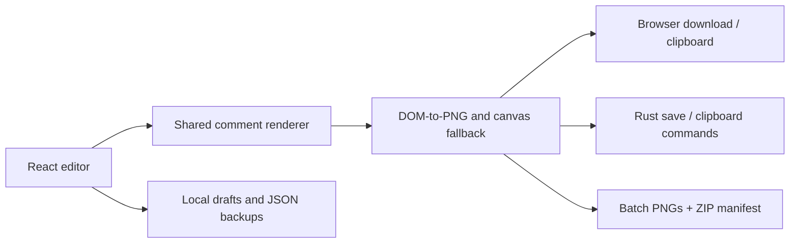

# Developer guide

[← Home](../README.md) · [User guides](USER_GUIDE.md) · [Contributing](../CONTRIBUTING.md)

## Architecture

The production frontend is embedded in a Rust/Tauri Windows executable. The browser edition uses the same React application and export renderer. There is no backend, account system, telemetry, or social-account integration.



## Prerequisites

| Task                          | Tools                                                              |
| ----------------------------- | ------------------------------------------------------------------ |
| Browser development           | Node.js 22.12+ and npm                                             |
| Automated browser tests       | Playwright Chromium                                                |
| Windows app development/build | Rust MSVC stable, Microsoft C++ Build Tools, Windows SDK, WebView2 |

The current release was built with Node.js 24 and the stable Windows MSVC Rust toolchain. See the [official Tauri prerequisites](https://v2.tauri.app/start/prerequisites/) for installation details.

## Run the browser editor

```powershell
git clone https://github.com/Haejinka/comment-studio.git
cd comment-studio
npm ci
npm run dev
```

Open http://localhost:5173. This development server listens on loopback. Keep the same hostname when working with local drafts.

## Run the native development window

```powershell
npm run desktop
```

This starts the Vite frontend and Tauri window. The distributed executable embeds the built frontend and does not require a server.

## Validate changes

```powershell
npx playwright install chromium
npm test
npm run build
cargo test --manifest-path src-tauri/Cargo.toml --locked
```

Browser tests cover templates, fields, images, formatting, themes, storage, backups, actual decoded PNG files, alpha transparency, 1×–4× dimensions, clipboard behavior, CSV/bulk ZIP exports, and editor layout. Rust tests cover file validation and available numbered filenames.

Screenshot/font rasterization varies by OS. Font checks allow a small rendering tolerance; the Windows build falls back to Inter when Proxima Nova is absent.

## Build Windows downloads

On a Windows development machine:

```powershell
npm run dist:win
npm run package:win
```

Tauri produces the standalone executable and NSIS installer under `src-tauri/target/release/`. The packaging script copies friendly download names, the icon, launch instructions, and checksums into `release/`.

The release workflow does not require a signing certificate. Builds are unsigned. Automatic in-app updates are not implemented.

## Native smoke testing

```powershell
node scripts/test-windows-app.mjs
```

This launches the release executable with a separate WebView2 profile and a temporary loopback debugging port. It exercises editing, avatars, badges, native image/text clipboard commands, draft refresh persistence, real Save As dialogs, PNG alpha/size checks, and ZIP decoding.

The script waits for a tester to complete the native Save As dialogs in the app, including a cancellation check. It is an interactive developer smoke test, not a headless CI test. It does not read normal app drafts. Close the test app normally after inspection.

## Update the documentation screenshots

With the browser development server running:

```powershell
npm run docs:screenshots
npm run docs:check
```

The capture script uses a fresh headless browser and fictitious sample content. Keep screenshots free of personal profiles, account data, and real uploaded photos. Documentation images are stored in `docs/images/`.

## Export implementation

`ExportAsset` is shared with the preview, but capture targets a separate unscaled instance containing only the comment and export padding. It waits for fonts and decoded avatars, renders with html-to-image, and falls back to html2canvas when needed. A generated blob must be nonempty and decodable.

The preferred-font-format filter is intentionally avoided: it can drop font-face rules and silently substitute fonts. The canvas fallback paints the TikTok tail explicitly and applies blur to marked text rectangles. A blur halo can soften adjacent pixels slightly.

Windows exports call narrow Rust commands that validate the extension and file data before opening Save As. Default filenames are chosen from available names in Downloads. Explicitly selecting an existing file retains Windows’ overwrite confirmation.

## Source map

| Path                               | Responsibility                                                   |
| ---------------------------------- | ---------------------------------------------------------------- |
| `src/App.tsx`                      | Editor shell, draft operations, presets, imports, export actions |
| `src/PlatformSelector.tsx`         | Platforms and template options                                   |
| `src/ProfileEditor.tsx`            | Avatar upload/drop and profile controls                          |
| `src/CommentForm.tsx`              | Text formatting, history controls, metadata                      |
| `src/PreviewWorkspace.tsx`         | Preview fit, zoom, comment theme, grid                           |
| `src/renderers.tsx`                | Platform layouts and shared export asset                         |
| `src/export.ts`                    | Capture, fallback, blob validation, browser/native saving        |
| `src/bulkExport.tsx`               | Sequential batch capture and ZIP/manifest                        |
| `src/storage.ts`, `src/backups.ts` | Local persistence and portable backups                           |
| `src/native.ts`                    | Browser/Tauri bridge                                             |
| `src-tauri/src/main.rs`            | Rust save, clipboard, and title-bar commands                     |
| `tests/`                           | Automated browser and export validation                          |
| `.github/workflows/ci.yml`         | Windows CI tests, build, downloadable artifacts                  |

## Limits and data handling

- CSV import: 500 rows; JSON draft backup: 30 MB / 500 comments.
- Uploaded avatars: 15 MB before resizing to 256×256.
- Output capture: 64 megapixels; native file payload: 256 MB.
- Drafts use localStorage in the active browser/app profile.
- ZIP generation keeps image blobs in memory.
- Visual redaction does not delete original text from stored records/manifests.

The content policy and Tauri capabilities keep the local frontend separate from general filesystem, shell, and network access. The app does not expose an arbitrary file-write command: supported file data is validated and the user chooses a destination in a native dialog.

Bundled font and graphic notices live in [public/licenses](../public/licenses/README.md). Project references are not runtime dependencies; screenshots of third-party sites are not published as documentation assets.
