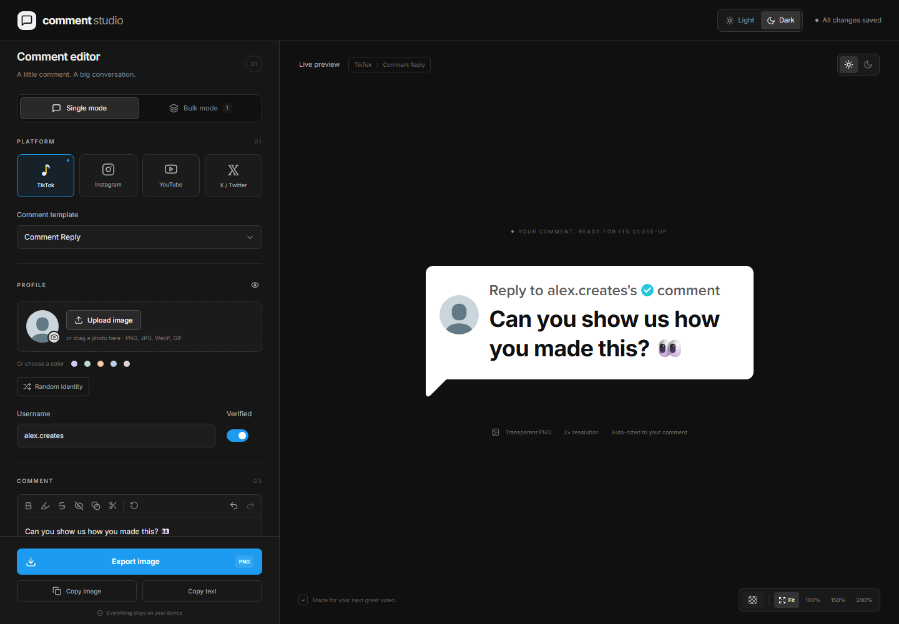
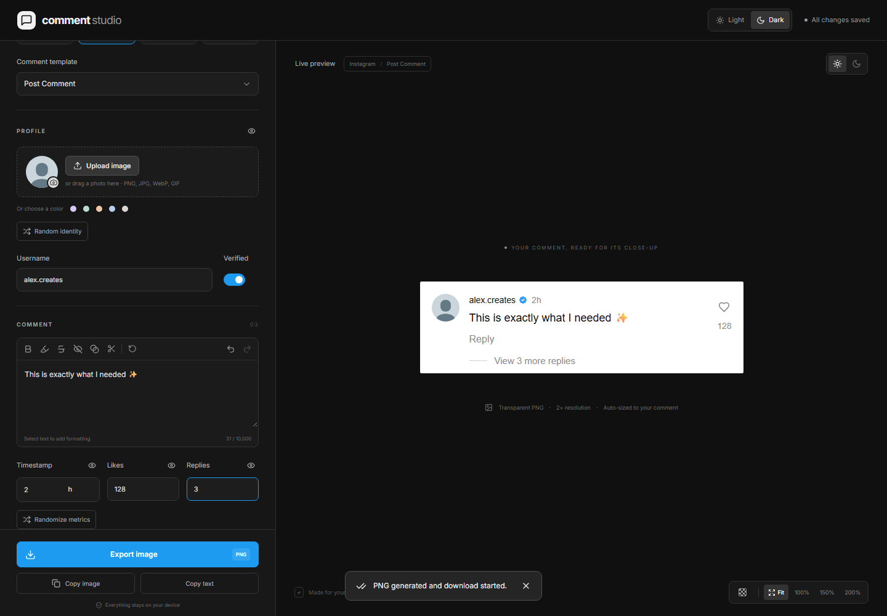

# Make your first comment image

[← Back to Comment Studio](../README.md) · [Download for Windows](https://github.com/Haejinka/comment-studio/releases/latest)

You can make an image without writing code or opening a terminal.

## 1. Download and open the app

Open the [latest release](https://github.com/Haejinka/comment-studio/releases/latest).

- Choose **Comment-Studio-Setup.exe** for a normal installation.
- Choose **Comment-Studio.exe** to open the app without installing it.

Both are for 64-bit Windows 10/11. The installer can add WebView2 if your computer needs it. [Having trouble opening it?](TROUBLESHOOTING.md)

## 2. Pick a platform and template

In the left sidebar, choose **TikTok**, **Instagram**, **YouTube**, or **X / Twitter**. Use **Comment template** below the platform buttons to choose a style.

Start with **TikTok → Comment Reply** for a speech-bubble overlay.

## 3. Add your name, photo, and text

1. Enter a **Username**.
2. Click **Upload image** to choose a profile photo. You can also drop a photo onto the upload area.
3. Type into **Comment text**.
4. Turn on **Verified** if you want a badge.

The preview changes as you type. **Replace image** changes an uploaded photo; the small remove button restores the placeholder.

## 4. Export the image

Click **Export image**, choose a folder, and click **Save**.

The default export is a transparent PNG at 2× resolution. It contains the comment asset, not the surrounding editor. Repeated exports suggest a new numbered filename.

To change the output, expand **Export settings**:

| Setting    | A useful starting point                          |
| ---------- | ------------------------------------------------ |
| Resolution | **2×** for most editing workflows                |
| Background | **Transparent** for a video overlay              |
| Padding    | **24 px** for comfortable space around the asset |

## 5. Use it in your video editor

Import the saved PNG into Premiere Pro, CapCut, DaVinci Resolve, or another editor that accepts PNG images. Place it above your footage on the timeline. Transparent pixels let the video show around the comment.

**Copy image** is useful for apps that accept pasted images. For video editing, saving a PNG gives you a file you can organize with the rest of your project.

> [!TIP]
> The header’s **Light / Dark** buttons change the app interface. The sun/moon buttons above the preview change the comment’s appearance. Choosing a light editor does not force a light comment.

## Keep a backup

Drafts save automatically on the same computer and app profile. For a separate copy, open **Draft backups → Export backup**. [Learn how to back up or move drafts →](BACKUPS.md)

**Next:** [Explore the controls](USER_GUIDE.md) · [Make a batch](BULK_AND_CSV.md) · [Get help](TROUBLESHOOTING.md)
