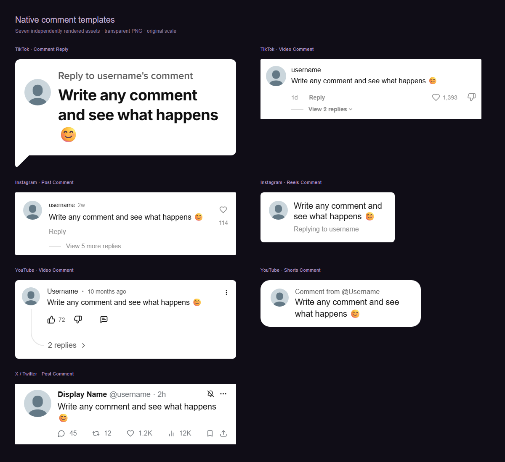

# Using the editor

[← Home](../README.md) · [Quick start](QUICK_START.md) · [Troubleshooting](TROUBLESHOOTING.md)

## Choose a comment style

| Platform    | Template       | Appearance                                          |
| ----------- | -------------- | --------------------------------------------------- |
| TikTok      | Comment Reply  | Large white/dark reply bubble with a speech tail    |
| TikTok      | Video Comment  | A comment row with inline reactions and replies     |
| Instagram   | Post Comment   | A post comment with a heart and reply thread        |
| Instagram   | Reels Comment  | Compact “Replying to…” sticker                      |
| YouTube     | Video Comment  | Comment with reactions and a curved reply connector |
| YouTube     | Shorts Comment | Rounded “Comment from @…” sticker                   |
| X / Twitter | Post Comment   | Name, handle, time, and engagement row              |

Switching styles preserves the fields you have entered. Some controls are hidden when a sticker template does not use them.

## Profile controls

- **Username / Display name:** the name shown in the image.
- **Handle:** the @name used by the X template.
- **Upload image / Replace image:** choose a PNG, JPG, WebP, or GIF. Images are center-cropped to a square and stored at 256×256. GIFs use a still frame.
- **Remove profile image:** return to a placeholder avatar.
- **Verified:** show or hide the template’s verification badge.
- **Eye button:** show or hide the profile section in the comment asset.
- **Color dots:** choose a placeholder color. Choosing one replaces an uploaded photo with the placeholder.
- **Random identity:** fill in a locally generated sample identity. It does not fetch a real person or profile.

Uploads are limited to 15 MB before resizing.

## Text formatting

Select part of **Comment text**, then choose a toolbar action. Formatting buttons apply to the whole comment when no text is selected.

| Action               | Result                                                |
| -------------------- | ----------------------------------------------------- |
| Bold                 | Makes the selected text heavier                       |
| Highlight            | Adds a yellow background                              |
| Strikethrough        | Draws a line through text                             |
| Redact               | Replaces visible characters with blocks               |
| Blur                 | Softens the selected text                             |
| Remove selected text | Deletes the selected characters; requires a selection |
| Reset formatting     | Clears formatting marks                               |
| Undo / Redo          | Moves backward or forward through editor changes      |

Redaction and blur are visual effects. Original text remains in stored drafts, plain-text copying, presets, and ZIP manifests. If it should no longer be in the draft, remove the text itself.

Outside text fields, **Ctrl+Z** undoes an editor change and **Ctrl+Shift+Z** redoes it. Inside text fields, the field’s normal editing shortcuts apply.

## Time and engagement

Depending on the template, you can edit the timestamp, unit, likes, replies, reposts, and views. The eye buttons show or hide the relevant metric. A reply count of `0` hides reply threads on templates that have them.

**Randomize metrics** generates local example values. These numbers do not come from a real social account.

## Preview controls

| Control                         | What it changes                           |
| ------------------------------- | ----------------------------------------- |
| App Light / Dark, in the header | Editor colors and the Windows title bar   |
| Sun / moon above the preview    | The comment image’s light/dark appearance |
| Fit                             | Fits the comment into the preview area    |
| 100%, 150%, 200%                | Preview magnification                     |
| Transparency grid               | The workspace checkerboard                |

Preview zoom and the grid are not part of the exported image. The two theme settings are independent and remembered locally.

## Export settings

- **Resolution:** 1×, 2×, 3×, or 4×. Start with 2×; use 4× when you need a larger asset.
- **Background:** transparent or a solid color.
- **Padding:** 0–120 pixels around the asset. The TikTok tail stays inside the export even at zero padding.
- **Height:** automatically follows the comment’s content.

Most templates are 525 px wide before padding; Reels is 319 px and Shorts is 381 px. For example, a 525 px comment with 24 px padding on each side exports at **1146 px wide at 2×**.

The app limits output to 64 megapixels. If a very long comment exceeds that, shorten it or reduce the resolution.

## Export, copy, and saving

**Export image** saves a PNG. Windows opens a Save As dialog; the browser edition starts a download. Cancelling a native dialog does not claim the file was saved.

**Copy image** copies image data. **Copy text** copies the original plain text. In the browser edition, image-copy permission failures can fall back to a download.

Repeated Windows exports use an available numbered default name. Manually selecting an existing file still uses Windows’ normal replacement confirmation.

## Presets and drafts

**Saved presets → Save current comment** keeps a reusable comment. Selecting a preset applies it to the current item.

Drafts save automatically. **Reset draft** restores the current item’s defaults. **Clear saved state** resets the working set, settings, and presets. Keep an [exported backup](BACKUPS.md) when you want a separate copy.
